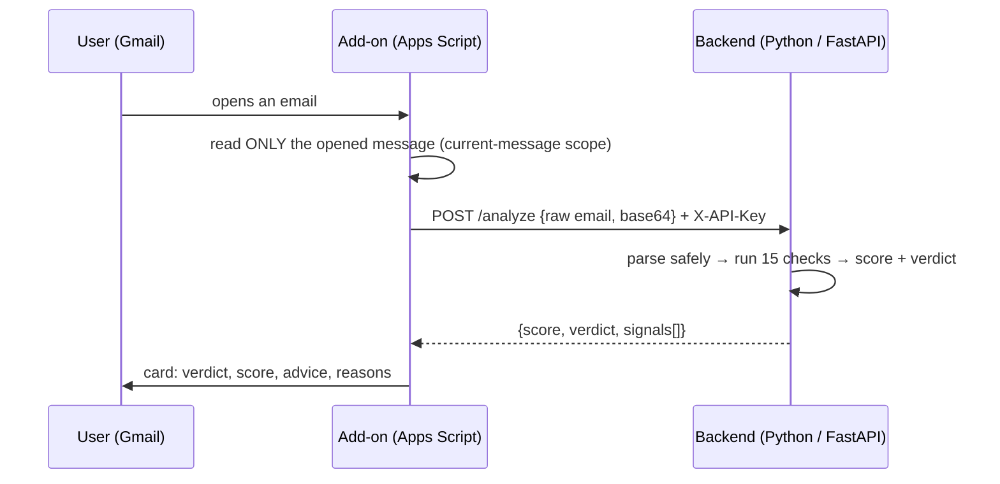

<p align="center"></p>

# 🐟🍟 Phish & Chips

**A Gmail add-on that tells you whether an email is fishy, and explains why in plain words.**

When you open an email in Gmail, the add-on shows a side panel with:

- a **verdict** in plain words: ✅ *Looks safe*, ⚠️ *Be careful*, or 🚨 *Likely a scam*
- a **risk score from 0 to 100**, with a one-line explanation of what the number means
- **what to do now** (e.g. "Don't click links; report it with Gmail's *Report phishing*")
- **what we noticed**: each reason in everyday language ("The sender is pretending to be you")
- **technical details** (collapsed): the exact evidence, for IT staff or reviewers

The guiding question was not *"is anything odd here?"* (marketing email is full of oddities) but
**"is someone lying to me, and asking me to act on that lie?"**

---

## Contents
1. [How it works](#1-how-it-works)
2. [How the score is calculated](#2-how-the-score-is-calculated)
3. [Testing on real email](#3-testing-on-real-email)
4. [Security and privacy](#4-security-and-privacy)
5. [Design decisions and trade-offs](#5-design-decisions-and-trade-offs)
6. [Running it](#6-running-it)
7. [Limitations and what I'd do with more time](#7-limitations-and-what-id-do-with-more-time)
8. [Repository layout](#8-repository-layout)

---

## 1. How it works



| Part | Responsibility | Why it lives there |
|---|---|---|
| **Add-on** (`addon/`) | Reads the opened message, sends it to the backend, renders the card | Apps Script is the only way to run inside Gmail. It is kept thin: no detection logic. |
| **Backend** (`backend/`) | Parses the email and decides | Python has a mature email parser and is easy to test. Detection logic can change without redeploying the add-on, and can be unit-tested offline against `.eml` files. |

The backend is also a command-line tool, which made developing and calibrating the rules fast:

```
python3 -m scorer some-email.eml
```

---

## 2. How the score is calculated

### The core idea: "suspicious" is not "malicious"

- **Suspicious** = something is unusual, but has an innocent explanation (a new sender, urgency
  words, tracking links). Legitimate emails do these things every day.
- **Malicious** = there is **evidence of deception** (about who sent it, or where a link goes)
  **and** a **harmful call to action** (click, log in, pay, open a file).

### Signals

Every check produces a signal with a plain-language title, an explanation, and the technical
evidence. Strong signals are evidence on their own. Weak signals are noise that only matters
when combined. 🎭 marks deception.

| ID | Signal | Points | Type |
|---|---|---|---|
| A1 🎭 | Sender not verified: no SPF/DKIM pass **aligned** with the `From` domain, and no DMARC pass for it | 30 | strong |
| A2 🎭 | Misleading display name: contains another domain's address, or the recipient's own name | 20 | strong |
| A3 🎭 | Look-alike domain (`paypa1`, `rnicrosoft`, `paypal-secure…`) | 30 | strong |
| A4 🎭 | Forged headers: self-asserted "Trusted Sender", or a server claiming to be Google | 20 | strong |
| B1 🎭 | Link text shows one domain, the link opens another | 30 | strong |
| B2 🎭 | Link to an HTML page on free/public hosting (e.g. `storage.googleapis.com/…/x.html`) | 25 | strong |
| C1 | Attachment that can run code (`.exe`, `.js`, `.py`, `.html`, `.iso`, …), including inside ZIPs | 30 | strong |
| C2 | Macro-enabled Office document | 25 | strong |
| C3 | Password-protected archive (can't be scanned) | 25 | strong |
| D1 | Urgency / pressure language (English + Hebrew) | 5 | weak |
| D2 | Asks for payment or login details (a "call to action") | 10 | weak |
| D3 | Hidden text (only elements that actually contain words) | 5 | weak |
| D4 | Attachment with (almost) no message | 10 | weak |
| D5 | Reply-To goes to a different domain | 10 | weak |
| D6 | Links go to other domains (usually click tracking) | 5 | weak |

### Combining them

1. `score = strong points + min(weak points, 30)`, capped at 100.
   The **cap on weak signals** means a noisy newsletter can never become "malicious" by
   accumulating small oddities.
2. **Deception rule:** if any 🎭 signal is present **and** the email asks the user to act
   (a deceptive link, a dangerous attachment, or a request for payment/login details), the score
   is raised to at least **70**.
3. Verdict: **0–24 safe · 25–59 suspicious · 60–100 malicious.**

### Context makes signals smarter

A few signals deliberately depend on whether the sender is verified, because that is the most
reliable fact we have:

- A link that goes through a known **click-tracking service** (`awstrack.me`, `sendgrid.net`, …)
  is normal for a verified sender, but still counts as a mismatch for an unverified one.
- The **exact brand name with another ending** (`amazon.dev`) is accepted for a verified sender
  (big companies own many domains). A **misspelling** (`arnazon.dev`) is never accepted.

---

## 3. Testing on real email

I calibrated the rules on 9 real emails from my own inbox (two online-shop order
confirmations, two Hebrew marketing newsletters, an e-invoice sent through a third-party
provider, a friend's email with study PDFs, a friend's ZIP of Python scripts with no text, an
Amazon verification code, and one real phishing email that had reached my inbox).
**They are not in this repository because they contain personal data.**

Final results:

| Email | Verdict | Why |
|---|---|---|
| Real phishing ("Cloud storage payment failed") | 🚨 100 | Unverified sender using my name, a fake "Trusted Sender" header, a link to an HTML page on public cloud storage, and a request to update payment |
| ZIP of `.py` files, empty message (friend) | ⚠️ 40 | Code inside an archive, no explanation. **Suspicious, not malicious**: the sender is verified and nothing is deceptive |
| E-invoice from a third-party provider | ⚠️ 25 | Display name is `E-invoice@uniqlo.vn`, but the email comes from `einvoice.com.vn`. Legitimate, but it is exactly the trick attackers use, so a warning is reasonable |
| Marketing newsletters ×2 | ✅ 15 | Only weak signals (urgency, hidden preview text, tracking links) |
| Order confirmations, PDFs from a friend, Amazon code | ✅ 0–10 | Verified senders, nothing deceptive |

### False positives the real emails exposed, and how I fixed them

| Problem | Fix |
|---|---|
| A jewelry newsletter was "suspicious" because it **sells** gift cards | Match the request ("buy gift cards"), not any mention |
| An e-invoice was "malicious": the link showed the invoice site but went through Amazon's click counter | Ignore known click trackers **only when the sender is verified** |
| A genuine Amazon code from `amazon.dev` was flagged as a look-alike of `amazon.com` | Exact brand name + verified sender = accepted; misspellings never are |
| 1-pixel divider lines were counted as "hidden text" | Count only hidden elements that contain words |

Synthetic, privacy-free versions of these scenarios are in `backend/tests/samples/` and are
covered by the unit tests:

```
cd backend
python3 -m unittest -v        # 13 tests
```

---

## 4. Security and privacy

Every email, attachment and response is treated as **untrusted input**.

**In the add-on**
- **Least privilege:** the add-on can read only the message the user opened
  (`gmail.addons.current.message.readonly`), never the mailbox.
- **Output escaping:** Gmail cards render a subset of HTML, so a sender name like
  `<font color=green>Verified</font>` could fake the UI. All email-derived text is HTML-escaped
  before display.
- **Outbound allow-list:** `urlFetchWhitelist` restricts where the add-on may send data.
  Even if someone changed the backend URL, the add-on would refuse other hosts.
- **No secrets in code:** the backend URL and API key live in Apps Script *Script Properties*.

**In the backend**
- **Authentication:** every `/analyze` call needs the shared API key (`X-API-Key`), compared in
  constant time. The server refuses to start without a strong key (≥ 32 characters) from an
  environment variable.
- **Forged authentication headers are ignored:** an attacker can write their own
  `Authentication-Results: … dmarc=pass` into the email. Only the topmost header stamped by
  the receiving server (`mx.google.com`) is trusted, and a DMARC pass must match the `From` domain.
- **Resource limits:** request and message size limits (Gmail's 25 MB plus margin); text is truncated
  before regex work; at most 500 archive members are listed.
- **Attachments are never executed or extracted**: ZIP files are only *listed* (names and the
  encryption flag) in memory.
- **No data retention:** emails are not stored. Logs contain only the verdict, score and signal
  IDs, never content or addresses. Errors return generic messages. API docs endpoints are disabled.
- **Container:** runs as a non-root user; the key is injected at runtime, not baked into the image.

**Privacy trade-off.** The add-on sends the raw email to the backend. That is the simplest way to
analyze headers and attachments, but it means the backend sees the full message. It is my own
service, it keeps nothing, and the transport is HTTPS. An alternative (section 5) is to extract
features inside the add-on and send only those.

**Platform limitation.** Gmail does not run add-ons on messages in **Spam** or messages it has
flagged as dangerous. I treat this as the product's scope: the add-on is a **second layer for
what reached the inbox**, which is exactly where users let their guard down.

---

## 5. Design decisions and trade-offs

| Decision | Alternatives considered | Why |
|---|---|---|
| **Weighted rules** | ML classifier; asking an LLM | The brief asks for an *explainable* verdict, and I had ~10 real labeled emails: not enough to train anything. Rules give a reason for every point. An LLM could be added later as **one more signal**, not the judge, because email content can contain prompt injection. |
| **Strong/weak split with a cap, plus a deception rule** | Plain sum of points | A plain sum made marketing mail look worse than real phishing (more hidden elements, more tracking links). The cap and the rule encode "suspicious ≠ malicious". |
| **Sender verification as the anchor** | Treat all signals independently | Alignment was the single feature that separated every legitimate sample from the phishing one, so it also decides how much to trust other signals. |
| **Plain-language explanations + collapsed technical details** | Show technical reasons | The users are not security people. On safe emails, minor signs are still listed (transparency), but under *"Small things we noticed (normal in many emails)"* and without warning badges, to avoid **alert fatigue**: warnings that appear on everything teach people to ignore warnings. |
| **Send the raw email to the backend** | Extract features in Apps Script | Simpler and complete (headers, MIME, attachments). Trade-off: privacy, discussed above. |
| **Backend runs locally behind a Cloudflare quick tunnel for the demo** | Cloud Run | Fastest path to a working end-to-end demo with no cloud account. A `Dockerfile` is included for Cloud Run. |

---

## 6. Running it

### Backend

Requires Python 3.10+.

```bash
cd backend
python3 -m pip install -r requirements.txt

# Create a secret and copy it to the clipboard (macOS), without printing it
export SCORER_API_KEY=$(python3 -c "import secrets; print(secrets.token_hex(24))")
printf '%s' "$SCORER_API_KEY" | pbcopy

python3 -m uvicorn app:app --port 8000
# check: http://localhost:8000/health  ->  {"status":"ok"}
```

Expose it so Google's servers can reach it. **Option A, for a demo:** a Cloudflare quick tunnel (no account needed).

```bash
cloudflared tunnel --url http://localhost:8000
# prints https://<random>.trycloudflare.com
```

**Option B, always on:** Google Cloud Run, using the included `Dockerfile`, with the key stored in Secret Manager.

```bash
gcloud run deploy email-risk-scorer --source backend --region europe-west1 \
  --allow-unauthenticated --set-secrets SCORER_API_KEY=scorer-api-key:latest
```

`--allow-unauthenticated` is required because authentication is done by the API key at the
application level.

### Add-on

1. Create a project at [script.google.com](https://script.google.com).
2. *Project Settings*: enable **Show "appsscript.json" manifest file in editor**.
3. Replace `appsscript.json` and `Code.gs` with the files from `addon/`.
4. *Project Settings* → **Script Properties**:
   - `BACKEND_URL`: the tunnel or Cloud Run URL, without a trailing path
   - `API_KEY`: the same secret the backend uses
5. **Deploy → Test deployments → Install**, then reload Gmail, open an email, and click the
   shield icon in the side panel.

### Command line

```bash
cd backend
python3 -m scorer path/to/*.eml
```

---

## 7. Limitations and what I'd do with more time

**Known limitations**
- Weights are hand-tuned on ~10 real and 7 synthetic emails. They are reasonable, not statistically calibrated.
- A **compromised legitimate account** (verified sender, nothing deceptive) is not detected.
- An attacker who registers `brand.xyz` **and** configures valid authentication is not caught
  by the look-alike check (domain age would catch it, see below).
- Only ZIP archives are inspected; no sandboxing of attachments or URLs.
- Brand list (~15) and keyword lists (English + Hebrew) are small.
- Organizational domains use a short built-in suffix list instead of the full Public Suffix List.
- No rate limiting on the API.

**Next steps, in priority order**
1. **URL reputation**: Google Safe Browsing / VirusTotal lookups for every link (cached; the key stays on the backend).
2. **Domain age** via RDAP: a sender or link domain registered days ago is a strong signal.
3. **User feedback button** ("This verdict was wrong") to collect labeled data, then calibrate the weights statistically.
4. **"Analyze a forwarded email"**: forward a suspicious message as an `.eml` attachment, so mail in Spam can be checked too.
5. Full Public Suffix List (`tldextract`), more archive formats, Hebrew UI.
6. Cloud Run + Secret Manager + rate limiting for an always-on deployment.
7. An LLM-based "does this text try to pressure or deceive?" signal, with its output treated as untrusted and weighted like any other signal.

---

## 8. Repository layout

```
docs/
  logo.png            project logo
  icon.png            square icon used by the add-on in Gmail
addon/
  appsscript.json     manifest: scopes (least privilege), URL allow-list, triggers
  Code.gs             calls the backend, renders the card (all email text escaped)
backend/
  app.py              FastAPI: auth, size limits, no content logging
  scorer/
    parser.py         safe MIME/HTML parsing, trusted auth header, ZIP listing
    signals.py        the 15 checks, with plain-language and technical explanations
    engine.py         scoring rules: weak-signal cap, deception rule, verdict bands
    domains.py        organizational-domain helpers
    __main__.py       command-line tool
  tests/
    build_samples.py  generates privacy-free synthetic emails
    samples/*.eml
    test_scorer.py    13 unit tests
  Dockerfile          for Cloud Run
```
